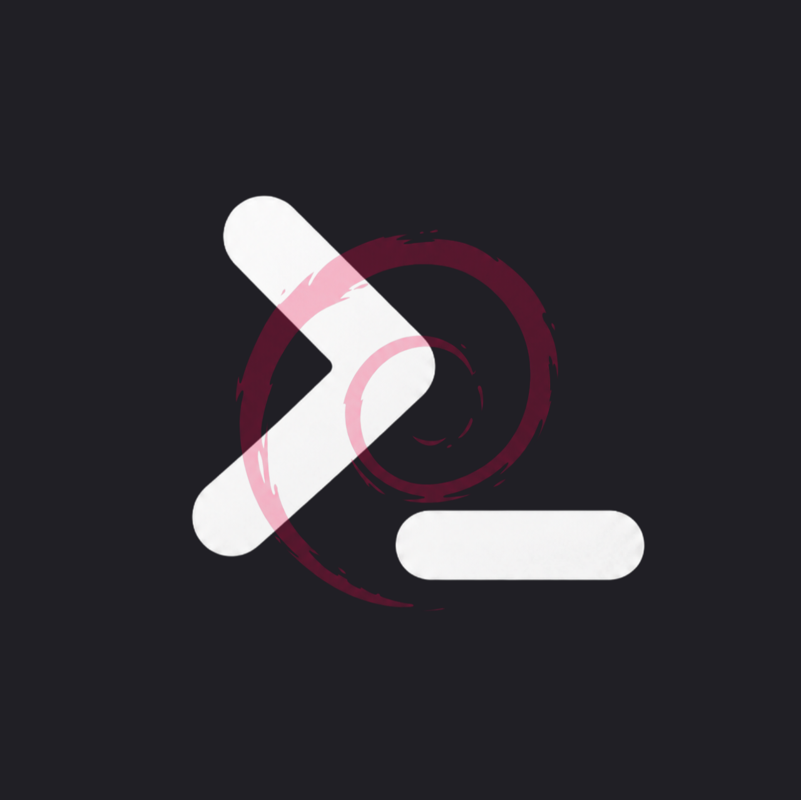
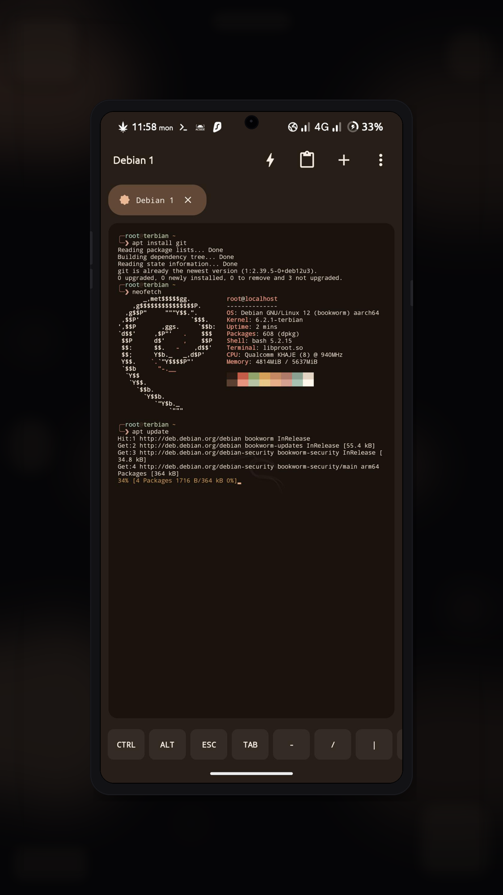
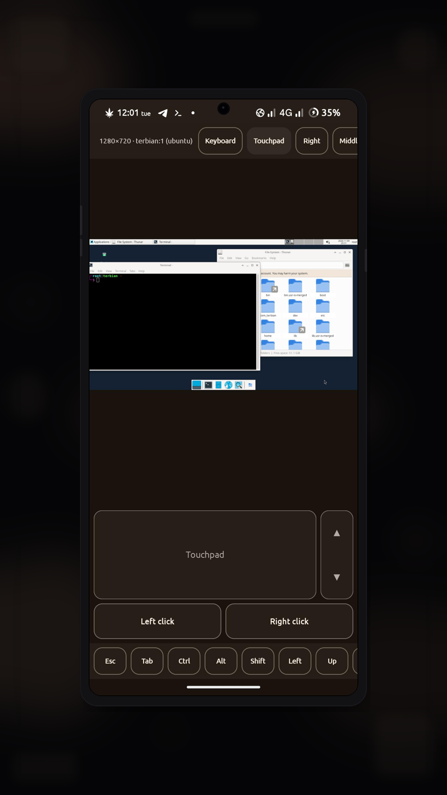
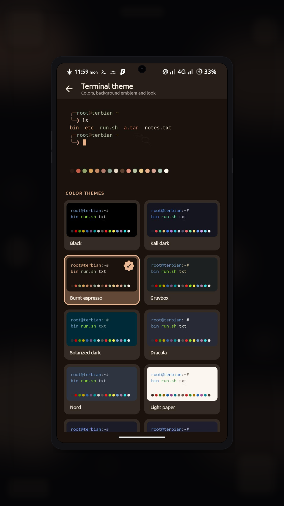
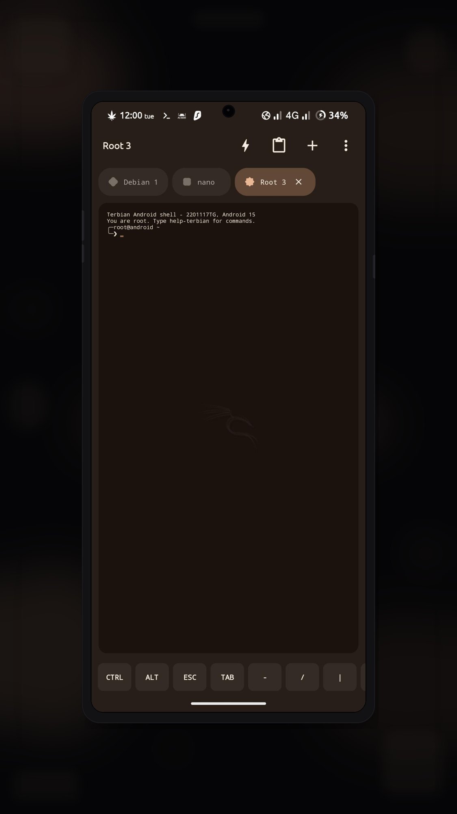

<div align="center">



# Terbian

**A full Debian & Ubuntu Linux terminal for Android. No root. No setup pain. Just open it and type.**

[](https://deepcodecreate.github.io/lumenstore/app.html?id=com.terbian)

[](https://github.com/deepcodecreate/Terbian-Debian-For-Android/releases/latest)
[](https://github.com/deepcodecreate/Terbian-Debian-For-Android/releases)
[](https://github.com/deepcodecreate/Terbian-Debian-For-Android/stargazers)
[](LICENSE)
[](#install)

[Download](https://github.com/deepcodecreate/Terbian-Debian-For-Android/releases/latest) · [Features](#features) · [Install](#install) · [Desktop mode](#desktop-mode) · [Build](#build-from-source)

</div>

<br/>

<div align="center">
  
  
  
  
</div>

<br/>

## Why Terbian

Your phone is a real computer. Terbian turns it into a proper Linux workstation: a genuine **Debian 12** or **Ubuntu 24.04** userland running through PRoot, wrapped in a modern **Material 3 Expressive** interface. Install packages with `apt`, run `git`, `python`, `gcc`, `vim`, `nginx` and thousands of other tools, or boot a full **XFCE desktop** and drive it with a touchpad, all without rooting the device.

## Features

| | |
|---|---|
| **Real Debian & Ubuntu** | Debian 12 (bookworm) and Ubuntu 24.04 rootfs bundled in the app. Install either one and switch between them. |
| **No root required** | Everything runs in user space through a Termux-derived PRoot build. |
| **Multi-tab sessions** | Open as many Debian, Ubuntu and local Android shell tabs as you like. Long-press a tab to close this one, the others, or all. |
| **Persistent sessions** | A foreground service keeps your shells alive while you switch apps. |
| **Desktop mode** | One command installs an XFCE desktop over TigerVNC. A built-in VNC viewer with touchpad, scroll strip and function-key bars shows it. Run several desktops at once. |
| **Material 3 Expressive** | Morphing shapes, dynamic color, adjustable corner roundness and text size, light, dark and pure-black AMOLED modes. |
| **Terminal themes** | Black, Kali dark, Burnt espresso, Gruvbox, Solarized dark, Dracula, Nord, Light paper and more, with Kali, Rounded and Arrow prompt styles and faint distro emblems behind the text. |
| **Extra keys row** | CTRL, ALT, ESC, TAB, arrows and symbols one tap away. |
| **Quick commands** | Save your own one-tap commands in the toolbar. |
| **Mirror manager** | Pick an apt mirror by country, enter your own URL, or jump straight into `nano` on your sources file. |
| **Built-in helpers** | `terbian-setup`, `terbian-gui`, `terbian-appimage`, `terbian-doctor` and `terbian-help` ship inside the rootfs. |
| **Adaptive icon** | Includes a monochrome layer for themed icons. |

## Install

<table>
<tr>
<td align="center" width="50%">

### Lumen Store

[](https://deepcodecreate.github.io/lumenstore/app.html?id=com.terbian)

</td>
<td align="center" width="50%">

### GitHub Releases

[](https://github.com/deepcodecreate/Terbian-Debian-For-Android/releases/latest)

</td>
</tr>
</table>

Every release ships one APK per CPU architecture plus a universal build. Pick the one that matches your device:

| File | For | Notes |
|---|---|---|
| `Terbian-<version>-arm64-v8a.apk` | Almost every phone and tablet made in the last decade | **Recommended** |
| `Terbian-<version>-armeabi-v7a.apk` | Older 32-bit ARM devices | |
| `Terbian-<version>-x86_64.apk` | Emulators, Chromebooks, Intel Android devices | |
| `Terbian-<version>-x86.apk` | 32-bit x86 emulators | Debian only, Ubuntu publishes no 32-bit x86 base image |
| `Terbian-<version>-universal.apk` | Any device | Much larger, it carries every architecture |

Not sure? Choose **arm64-v8a**. Verify downloads against `SHA256SUMS.txt` attached to each release.

## First run

1. Open Terbian and let it install the Debian rootfs (takes a moment, fully offline).
2. Run `terbian-setup` once to get `nano`, `vim`, `git`, `python` and build tools.
3. Install anything else with `apt install <package>`.

```bash
terbian-help
apt update && apt install neofetch
neofetch
```

## Desktop mode

```bash
terbian-gui install
terbian-gui start
```

Or use the **Terbian GUI** menu inside the app. The desktop opens in the integrated viewer with a touchpad, scroll strip, keyboard and function-key bars, all following your app theme.

## What does not work

PRoot cannot provide systemd, kernel namespaces or mounts, so **snap** and **Flatpak** are unavailable. Use `apt` packages or `terbian-appimage` for AppImages instead. On Ubuntu, `terbian-gui install` takes care of Firefox through the Mozilla PPA.

## Build from source

You need JDK 17 and the Android SDK (platform 36).

```bash
git clone https://github.com/deepcodecreate/Terbian-Debian-For-Android.git
cd Terbian-Debian-For-Android
./gradlew assembleDebug
```

Useful Gradle properties:

| Property | What it does |
|---|---|
| `-PskipNative` | Skip proot and rootfs downloads |
| `-PskipProot` | Skip only the proot build |
| `-ProotfsArch=arm64v8,amd64` | Rootfs architectures to bundle: `arm64v8`, `arm32v7`, `amd64`, `i386` (comma separated) |
| `-PonlyAbi=arm64-v8a` | Build a single ABI, or `universal` for one fat APK |
| `-PappVersionName=2.6.0 -PappVersionCode=20600` | Override the app version |
| `-PforceProot` | Force the proot rebuild |

Native libraries for other ABIs are produced with the NDK by `app/tools/build-native.sh`. The rootfs can be fetched manually with `app/tools/fetch-rootfs.sh [arch]`.

## Releasing

Pushing a version tag builds all four architectures plus the universal APK, signs them and publishes the GitHub release automatically. Creating a release with a new tag from the GitHub web UI works too: the empty release is filled with the APKs.

```bash
git tag v2.6.0
git push origin v2.6.0
```

The version name and code are derived from the tag. Signing uses these repository secrets (Settings, Secrets and variables, Actions):

| Secret | Value |
|---|---|
| `KEYSTORE_BASE64` | `base64 -w0 release.keystore` |
| `KEYSTORE_PASSWORD` | Keystore password |
| `KEY_ALIAS` | Key alias |
| `KEY_PASSWORD` | Key password |

## Project layout

```
app/src/main/java/com/terbian     app code: ui, terminal, debian, gui, vnc
app/src/main/java/com/termux      terminal emulator and view (from Termux)
app/src/main/assets/debian-tools  helper scripts installed into the rootfs
app/src/main/jniLibs              proot, loader and pty libraries per ABI
app/tools                         native and rootfs build scripts
.github/workflows/release.yml     tag-driven release pipeline
```

## Contributing

Issues and pull requests are welcome. If Terbian is useful to you, a star helps other people find it.

## Credits

Built on [Termux](https://github.com/termux/termux-app) terminal components, the [Termux PRoot fork](https://github.com/termux/proot), [libandroid-pty](https://github.com/z80oolong/libandroid-pty), and the official Debian and Ubuntu root filesystems. Full details are in [NOTICE](NOTICE).

## License

Copyright 2026 deepcodecreate. Licensed under the [Apache License 2.0](LICENSE).
